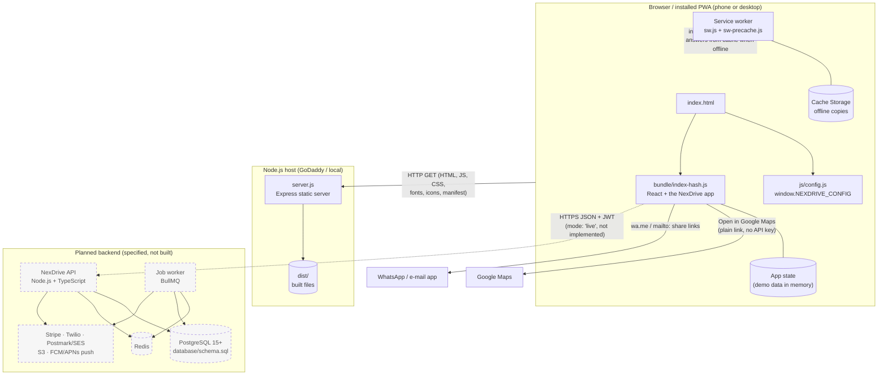
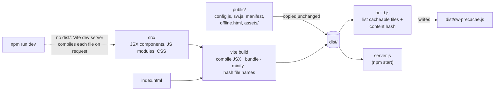
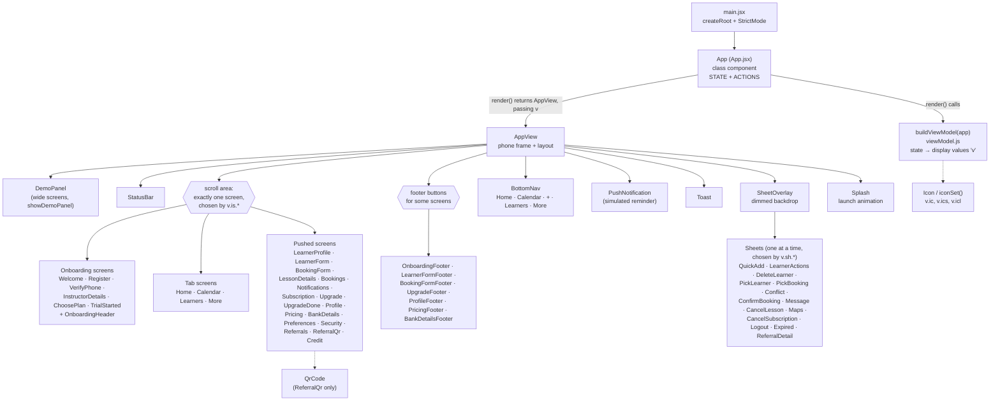
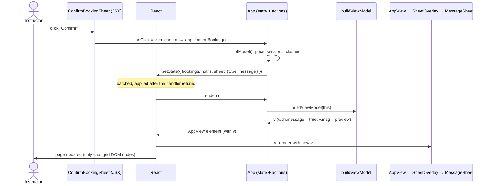
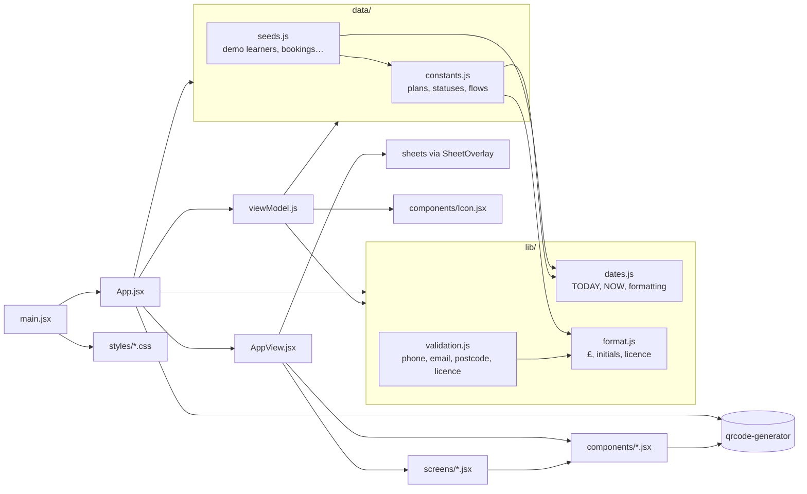

# Component diagrams

Five views of the same system, from the outside in. Dashed boxes and arrows are **planned but not built**. Background on each part: [overview.md](overview.md).

## 1. The running system

What exists at runtime today, and where the planned backend would attach.

## 2. Build and deploy pipeline

How source files become what the server serves.

On the hosting, the platform runs `npm install` → `npm run build` → `npm start`.

## 3. React component tree

Who renders whom. Only `App` holds state. Every other box is a stateless function that receives the same view-model object `v`.

Footer components live in the same file as their screen (for example `LearnerFormFooter` is exported from `screens/LearnerForm.jsx`).

## 4. One interaction, end to end

Tapping **Confirm** in the "Confirm booking" sheet.

## 5. Module dependencies inside `src/`

Arrows point from the importer to what it imports. Nothing in `lib/` or `data/` imports React.

