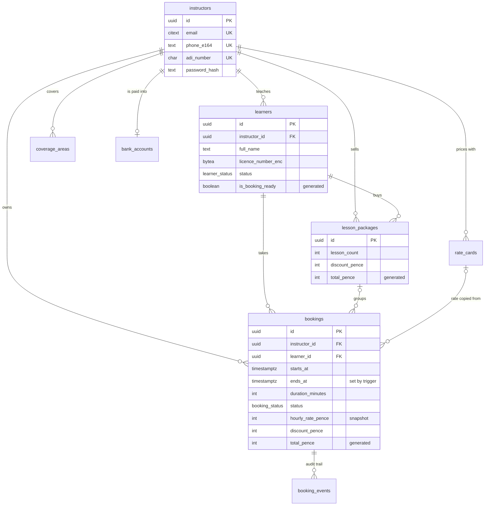
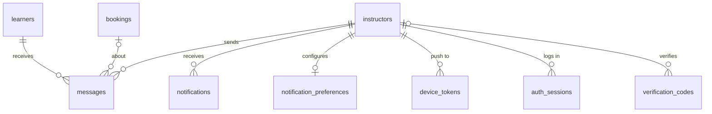
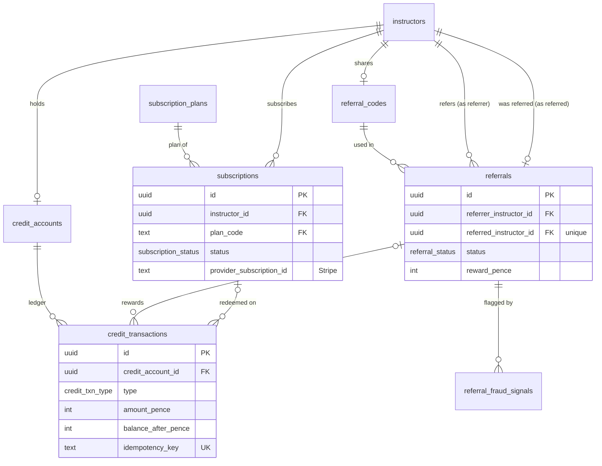

# Database: model and usage

## 1. Current status: designed, not connected

| Item | State |
| --- | --- |
| Engine | PostgreSQL 15+ (local Docker setup uses 16) |
| Schema | Complete: `database/schema.sql` (= migrations 001 + 002 concatenated) |
| Reference data | `database/seed.sql`: the four subscription plans (required in every environment) |
| Demo data | `database/demo_data.sql` (SQL) and `database/sample_data.json` (the same data in API JSON shape). Local/staging only |
| Code that reads/writes the DB | **None.** No API exists yet, and `server.js` has no database driver |
| Front end | Uses its own in-memory demo data (`src/data/seeds.js`), which mirrors `demo_data.sql` |

So everything below describes **how the database is designed to be used** by the planned API (`API_DOCUMENTATION.md`), plus the gaps between that design and what the front end does today (section 7).

## 2. Conventions used throughout the schema

| Convention | Detail |
| --- | --- |
| Keys | `uuid` primary keys, generated by `gen_random_uuid()` (pgcrypto) |
| Multi-tenancy | Every business table has `instructor_id`. An instructor is the tenant; the API must filter every query by the instructor in the JWT |
| Time | `timestamptz` everywhere (stored UTC, shown in Europe/London) |
| Money | Integer **pence** (`*_pence` columns). Never floats |
| Durations | Integer minutes |
| Soft delete | Learners are archived (`status='archived'`, `archived_at`), never deleted, so lesson history survives |
| Derived values | Computed by the database: `GENERATED ALWAYS … STORED` columns (`price_pence`, `total_pence`, `is_booking_ready`) and triggers (`ends_at`, `updated_at`) |
| Sensitive fields | Licence numbers and bank details are stored encrypted (`*_enc bytea`) plus a plain "last 4" for display |
| Enums | PostgreSQL `ENUM` types for statuses (`booking_status`, `subscription_status`, …) |

## 3. Entity-relationship diagrams

The schema has 22 tables, so it is drawn in three parts. `instructors` appears in each part because nearly every table belongs to an instructor.

### 3.1 Learners and lessons

### 3.2 Messages, notifications and sign-in

### 3.3 Subscriptions, referrals and NexDrive Credit

## 4. Tables by area

### Accounts and settings

| Table | Purpose | Notable rules |
| --- | --- | --- |
| `instructors` | The account and tenant: profile, ADI number, password hash (argon2id), verification timestamps | E.164 UK mobile format check; 6-digit ADI; `deleted_at` soft delete |
| `coverage_areas` | Postcode districts served (`SL1`, `SL2`…) | Composite PK (instructor, code) |
| `rate_cards` | Hourly rates (Standard, Intensive, Pass Plus) | At most one `is_default` per instructor (partial unique index) |
| `bank_accounts` | Payout details shown in booking messages | Sort code / account number encrypted; only last digits in clear |
| `notification_preferences` | Reminder timing, alert toggles, default message channel | One row per instructor |
| `device_tokens` | Push-notification tokens per device | |
| `auth_sessions` | Refresh tokens (stored as SHA-256 hash), expiry, revocation | |
| `verification_codes` | SMS/e-mail codes (hashed), max 5 attempts | |

### Learners and lessons

| Table | Purpose | Notable rules |
| --- | --- | --- |
| `learners` | Students. Contact, encrypted licence, theory certificate, notes | `is_booking_ready` is a generated column (phone, address, postcode and licence all present). Archive, don't delete |
| `lesson_packages` | A multi-lesson purchase with a package-level discount | `total_pence` generated; discount ≤ subtotal |
| `bookings` | One lesson | See below |
| `booking_events` | Append-only audit trail (created / rescheduled / cancelled …) with before/after JSON | Powers "moved from … to …" messages |
| `messages` | Every SMS/WhatsApp/e-mail sent to a learner, with provider status | `learner_id` is `ON DELETE RESTRICT` (history survives) |
| `notifications` | In-app notification centre | Partial index on unread |

**`bookings` in detail:** this is the heart of the system.

- `ends_at` is set by a trigger from `starts_at + duration_minutes`.
- `hourly_rate_pence` is **copied** from the rate card at booking time, so later price changes don't rewrite history. `price_pence` and `total_pence` are generated from it.
- **No double-booking:** `bookings_no_overlap` is an `EXCLUDE USING gist` constraint. It forbids two non-cancelled bookings for the same instructor whose `[starts_at, ends_at)` ranges overlap. It needs the `btree_gist` extension. On a violation PostgreSQL raises SQLSTATE `23P01`, which the API should turn into `409 BOOKING_CONFLICT`.
- `status` is only `scheduled / completed / cancelled / no_show`. The five statuses the UI shows (Upcoming, Ongoing, Completed, Cancelled, Rescheduled) come from the **view** `booking_display`, which computes `display_status` from `now()`, the times and `reschedule_count`.
- `status = 'cancelled'` ⇔ `cancelled_at IS NOT NULL` (CHECK).

### Subscriptions and billing

| Table | Purpose | Notable rules |
| --- | --- | --- |
| `subscription_plans` | Reference data: `1m`, `12m`, `24m`, `36m` with monthly-equivalent and per-term price | Filled by `seed.sql`. **Prices are placeholders** |
| `subscriptions` | An instructor's plan, trial dates, Stripe IDs, card brand/last 4, referral free month | Only one live (`trialing/active/past_due`) subscription per instructor (partial unique index) |

### Referral programme and NexDrive Credit (migration 002)

| Table | Purpose | Notable rules |
| --- | --- | --- |
| `referral_codes` | One shareable code per instructor (`NEX` + name + 2 digits) | Format CHECK `^NEX[A-Z]{1,8}[2-9][0-9]$` |
| `referrals` | Referrer → referred relationship and its lifecycle (`registered → … → awarded`, or `not_qualified` / `reversed`) | A new instructor can be referred only once (unique); no self-referral (CHECK) |
| `referral_fraud_signals` | Internal evidence (same phone, card, device…) | Never shown to instructors |
| `credit_accounts` | Current credit balance and totals | Balance can't go negative |
| `credit_transactions` | **Append-only ledger** of every credit movement, with running `balance_after_pence` and an `idempotency_key` | A trigger rejects UPDATE/DELETE; at most one reward per referral |

## 5. How the API is meant to use the database

Distilled from `DATABASE_SETUP.md`, `DEVELOPER_HANDOVER.md` and `API_DOCUMENTATION.md`.

1. **Tenant filter on every query.** `WHERE instructor_id = $tokenInstructorId`. A row belonging to another instructor must return 404. Recommended second layer: PostgreSQL **row-level security** policies keyed on `SET LOCAL app.instructor_id`, with the API connecting as a non-owner role.
2. **Let the database enforce invariants**, and translate errors:
   - an exclusion violation (`23P01`) → `409 BOOKING_CONFLICT`
   - `is_booking_ready = false` → `422 LEARNER_INCOMPLETE`
   - CHECK failures → `422`
3. **Recalculate money on the server.** Totals sent by the client are display-only. The generated columns are the source of truth.
4. **Encryption in SQL.** Write with `pgp_sym_encrypt($value, $key)` and read with `pgp_sym_decrypt(...)`, only where the full value is needed. The key (`FIELD_ENCRYPTION_KEY`) is passed as a query parameter, never stored or logged.
5. **Credit ledger posting** in one transaction:
   1. `SELECT … FOR UPDATE` the `credit_accounts` row.
   2. Insert into `credit_transactions` with the new running balance and an idempotency key.
   3. Update the account totals and the referral's status.

   A nightly reconciliation query checks that each balance equals the last ledger row.
6. **Background jobs** (planned BullMQ worker on Redis):
   - mark past lessons completed
   - send lesson reminders `lesson_reminder_minutes` before start
   - send trial-ending notices
   - run the referral award and reversal steps from Stripe webhooks
   - retention clean-up
7. **Migrations.**
   - A fresh database runs `schema.sql`. An existing one applies `migrations/NNN_*.sql` in order. Use one approach or the other on a given database, never both.
   - Then run `seed.sql` everywhere, and `demo_data.sql` on local/staging only.
   - Never edit an applied migration. No migration-tracking tool is chosen yet.

## 6. How to load it locally

See [setup.md §7](setup.md#7-optional-load-the-planned-database-locally). `docker-compose.yml` starts PostgreSQL 16 and Redis 7; the three `psql` commands load schema, plans and demo data.

## 7. Front-end model vs database model

When the API is built, the front end's data will have to be mapped. Differences to plan for:

| Topic | Front end today (`src/`) | Database |
| --- | --- | --- |
| IDs | Short strings: `'L1'`, `'b10'`, `'R6'`, or `'L' + Date.now()` | UUIDs |
| Money | Pounds as JS numbers, sometimes fractional (`17.5`, `discount: 2`) | Integer pence |
| Lesson time | `date: 'YYYY-MM-DD'`, `start: 'HH:MM'`, `dur` in **hours** (`1.5`) | `starts_at timestamptz`, `duration_minutes` |
| Booking status | Stored as display status: `upcoming`, `ongoing`, `completed`, `cancelled`, `rescheduled` | `scheduled/completed/cancelled/no_show`, display status via `booking_display` view |
| Reschedule history | `prev: {date, start}` on the booking | `rescheduled_from`, `reschedule_count`, `booking_events` |
| Licence / bank | Plain text in memory | Encrypted columns + last digits |
| Phone | `'07700 900456'` | E.164 `'+447700900456'` |
| Referral status | `registered`, `trial`, `free_month`, `confirmed`, `awarded`, `not_qualified`, `reversed` | `started`, `registered`, `subscribed`, `trialing`, `free_month`, `payment_confirmed`, `awarded`, `not_qualified`, `reversed` |
| Subscription state | `active`, `trial`, `payment_failed`, `expired`, `cancelled` | `trialing`, `active`, `past_due`, `cancelled`, `expired` |
| Notifications | Includes `act` (deep-link target) and a `time` label | `payload jsonb`, `created_at` |

`DEVELOPER_HANDOVER.md` appendix A4 lists which front-end action should call which endpoint.
